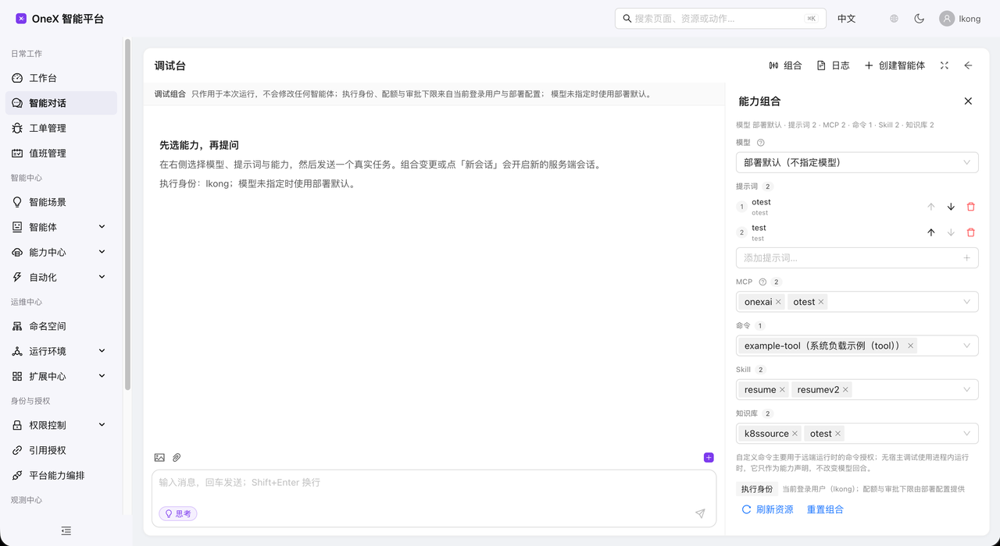
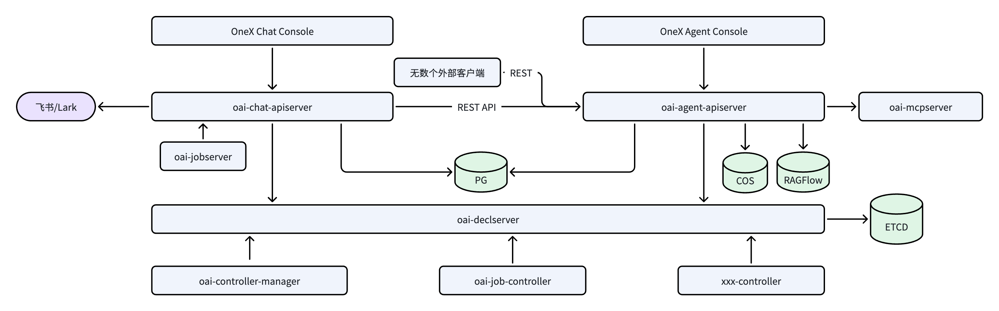

[项目文档]: https://onex.feizaonet.com
[安装指南]: https://onex.feizaonet.com
[开发指南]: https://onex.feizaonet.com
[功能列表]: https://onex.feizaonet.com

# OneX 智能体平台

[简体中文](README.md) · [English](README.en.md)

OneX 智能体平台（简称：onexai，也称 OneX AI）是一个企业级的、功能完备的智能体平台，可以帮助企业完成内部的智能化转型。另外，OneX 智能体平台也内置了一个基于飞书的机器人，可以将整个智能化能力接入飞书 IM 应用，从而进一步提高企业的智能化使用体验。

>- OneX AI 开发课程：[Go 项目开发中级实战课](https://onex.feizaonet.com/product/prd-course-go-intermediate)
>- OneX AI 采用的 Harness AI Coding 工具：[OneX Harness AI Coding 实战课](https://onex.feizaonet.com/product/prd-r3tmnt)
>- OneX AI 采用采用了课程：[Kubernetes 源码剖析与实战](https://onex.feizaonet.com/product/prd-course-k8s-source) 中的很多设计理念和方法



## 功能特性
OneX 智能体平台具有很多优秀的特性：
- 完善的智能化能力： OneX 智能体平台具有完善的智能化能力。包含并不限于以下功能模块：智能对话、模型管理、Prompt 管理、Skill 管理、MCP 管理、知识库管理、值班模块管理、工单管理、凭据管理、权限管理等；
- 采用声明式架构： OneX 智能体平台底层核心能力通过声明式架构来实现。在 OneX 智能体平台中，声明式架构有 2 层含义：
  - 底层软件架构采用声明式编程范式来开发： 声明式编程范式给 OneX 智能体平台带来了很多收益，例如：极低的延时、毫秒级响应、非常强大的扩展能力等。当然，也带来了一些技术复杂度，但是在 AI 时代，这不是问题；
  - 功能声明式： 在 OneX 智能体平台，你可以通过一段 Prompt 来声明你想要的能力。OneX 平台会根据你的期望，从整个平台能力矩阵中，动态的给你组装一个符合你要求的智能体。也即：OneX 平台实现了 Agent 能力的声明式创建；
- 可插拔架构： 平台中的智能化能力以可插拔的形式接入。接入新的智能化能力，不需要修改底层的代码，只需要通过简单配置即可集成各类能力；
- 基于 ReAct 的 Agentic 架构： OneX 智能体平台底层的智能化能力摒弃了传统的 Dify 工作流，借助于 LLM 的 ReAct 能力实现智能化能力。
- 标准化的 MCP Tool 实现方式： OneX 智能体平台基于标准的 MCP 协议，进一步将 MCP Tool 的开发标准化，以提高 MCP Tool 开发的效率和效果；
- 跟飞书机器人的强大联动： OneX 智能体平台自带一个飞书聊天机器人OneX，该机器人支持非常强大的能力：
  - `/xxxx` 命令支持： 机器人能够解析非常复杂的 `/xxxx` 命令，能够跟 `kubectl` 工具命令实现一致的解析体验；甚至，你在飞书中可以直接使用 `/kuebecl` 来操作 k8s 集群（当然考虑到安全，这里只读，而且有权限控制）；
  - 专属 SKILL 编写方法： 在很多 SKILL 中，是通过 Prompt 的方式来编写 SKILL的，但是在 OneX 平台，你可以直接在 SKILl 中，告诉智能体，请使用 `/xxxx` 先查询 `xxx` 这种运维式的 SKILl 编写方式。将 Prompt 的解析不确定性，转换为命令的确定性；
  - SKILL 及命令： 如果你的智能体具有一些 SKILL，例如：`resume-review`，那么你可以在飞书中通过 `/resume-reviewd` 命令直接调用该 SKILL；
  - 命令调度： OneX 机器人，可以根据你的权限，调度合适的Agent给你，并且Agent 支持通过一些规则、算法，来设置  Agent 所具备的命令，这些命令也代表着能力；
  - 自定义命令： 支持 mcp tool、prompt、http 类型自定义命令；
  - 很好的聊天交互： 在跟 OneX 机器人聊天的时候也能有一个很好的交互体验，推理、工具、耗时、Token 消耗、工具执行结果等核心数据它都会以合理的方式，渲染在飞书卡片中；
- 调试能力： OneX 智能平台具备强大的调试能力，可以让业务根据需要自由配置（模型、知识库、SKILL、MCP Tool）四元组，并进行智能效果测评；
- 智能测评（`/ailab`）： OneX 智能平台提供智能测评能力。由 LLM 自动测评，并选择出效果最好的（知识库、SKILL、MCP Tool）三元组；
- 非常强大的安全能力：
  - Agent 运行时安全： 抛开 Agent 运行时沙箱，Agent 本身具备高危命令屏蔽及审核安全机制、具备输入、输出安全审计及门控能力；
  - 资源鉴权： OneX 智能体平台支持以下维度的鉴权：租户、Agent、SKILL、MCP、知识库、MCP Tool、MCP Tool所操作的具体资源等。当然，平台处除了上述预定义资源鉴权外，还支持各类自定义资源的鉴权；
  - 平台内置了多种鉴权方式： 支持 OPA、Casdoor、CMDB 等鉴权方式；
  - Webhook 扩展： 支持通过 Webhook 的方式自定义鉴权方式
  - 支持 Agent 级鉴权： 每个 Agent 均可以设置独立的鉴权方式。如果没有设置，则复用平台内置的鉴权逻辑；
  - 支持 用户、用户组、服务账号等鉴权主体；
  - 其他各类黑白名单等等....
- 高阶智能体能力：
  - Human-in-the-Loop (人机协作)： 支持 HITL，可以通过人机协作、交互的方式，来完成任务；
  - 支持多模态： 支持图片、文本、Word文档、PDF等数据类型；
  - 智能体调度： 类似 Kubernetes 调度器，OneX 支持非常复杂、高扩展的智能体调度算法；
  - 异步任务/任务： OneX 智能体平台不仅支持异步任务，还支持单次任务。例如：你可以告诉 OneX智能体，请每天xxx时间，帮我汇总下股票新闻。也可以告诉OneX，请明天10点，提醒我去赶飞机；
  - 智能体自我进化能力： OneX 平台的智能体具备自我进化能力，能够根据数据进行自我的优化、成长；
  - 多 Prompt： Agent 支持多 Prompt 聚合能力。也支持对聚合后的 Prompt 进行二次修改；
  - 支持 Agent 引用： 也即 Agent A 可以引用 Agent B + Agent C的所有能力；
  - 支持批处理： 支持声明式的方式对全平台所有 Agent 添加某种能力；
  - 具备常记忆能力
  - Agent 运行时：支持 Eino、容器等Agent运行时；
- 插件化的智能场景支持： OneX 智能体平台，可以用插件化的方式集成各种智能场景，而不用开发一行代码，例如：RCA、找人问路、服务发布、服务重启、知识问答等等。


## 架构



## 快速开始

### Docker Compose（一条命令）

```bash
cd manifests/installation/compose
cp env.example env      # 设置 LLM_BASE_URL 和 LLM_API_KEY
docker compose --env-file env up -d --build
./smoke.sh
```

该命令会启动控制平面、两个 API Server、任务 Worker、A2A 运行时、PostgreSQL、
Redis 和 etcd。Kafka 和 `oai-mqserver` 不在此部署栈中。端口、配置覆盖项和安全
配置档（secure profile）的说明见 [Docker Compose](docs/en-US/docker-compose.md)。

### 从源码开始

#### 前置条件

- Go **1.27+**
- PostgreSQL 16+（推荐）或 MySQL 8+（通过 `coredb.dialect` 设置）
- `oai-declserver` 需要 etcd 3.5+
- 可选：Kafka、Redis、LLM 服务端点、飞书（Lark/Feishu）凭据

#### 构建

```bash
make build          # 将 cmd/ 下的所有二进制构建到 _output/platforms/<os>/<arch>/
make test           # 单元测试（使用 -race；Linux）
CGO_ENABLED=0 go test -short ./...  # macOS/arm64
make lint.defensive # 合并门禁（merge-gating）的 lint 配置
```

#### 本地运行

1. 启动 etcd 和 PostgreSQL。
2. 启动控制平面：

   ```bash
   _output/platforms/$(go env GOOS)/$(go env GOARCH)/oai-declserver \
     --etcd-servers=http://127.0.0.1:2379 \
     --secure-port=6444 \
     --cert-dir=$HOME/.onexai/controlplane/certs
   ```

3. 应用初始 RBAC 绑定（可选，用于 SRE/管理员名单）：

   ```bash
   kubectl --kubeconfig ~/.onexai/declserver.kubeconfig apply -f hack/rbac-bindings-seed.yaml
   ```

4. 使用示例配置启动运行时服务：

   ```bash
   cp configs/examples/oai-agent-apiserver.example.yaml /tmp/oai-agent-apiserver.yaml
   cp configs/examples/oai-chat-apiserver.example.yaml  /tmp/oai-chat-apiserver.yaml
   _output/platforms/$(go env GOOS)/$(go env GOARCH)/oai-agent-apiserver --config /tmp/oai-agent-apiserver.yaml
   _output/platforms/$(go env GOOS)/$(go env GOARCH)/oai-chat-apiserver  --config /tmp/oai-chat-apiserver.yaml
   ```

5. 或者渲染 Helm Chart：

   ```bash
   helm template onexai manifests/installation/charts/onexai
   ```

完整的操作流程见 [docs/en-US/quickstart.md](docs/en-US/quickstart.md)。

## 配置

- 示例配置位于 `configs/examples/`。复制一份、填入密钥，然后通过 `--config`
  传入。
- 密钥也可以通过环境变量提供（例如
  `OAI_CHAT_APISERVER_BACKEND_REGEN_PASSWORD`），而不必写入 YAML 文件。
- 控制平面连接由 `controlplane.kubeconfig` 和 `controlplane.namespace` 指定。
- 值班（Duty）选择：

  ```yaml
  duty:
    provider: regen   # none | regen；为空时根据 backend.regen-endpoint 推断为 regen
  ```

## 代码仓库结构

```text
cmd/                 8 个服务入口
internal/            服务实现（handler → biz → store）
pkg/                 公共包：API、控制平面客户端、duty 契约、共享客户端
api/openapi/         生成的 OpenAPI 文档
configs/             服务示例配置
manifests/           Helm Chart 和 Kubernetes 清单
docs/                双语文档
hack/                开发与运维辅助脚本
scripts/             构建、代码生成和发布脚本
third_party/         可复现构建所需的补丁分支
```

内部包遵循整洁架构（clean architecture）：`handler` 负责适配传输层，`biz` 承载
领域逻辑，`store` 负责持久化，`wire` 负责依赖注入。

## 开发

```bash
make deps           # 安装代码生成和 lint 工具
make generate       # 执行 go:generate 指令
make protoc         # 重新生成 protobuf/gRPC/OpenAPI 代码
make format         # goimports（见下方说明）
make test
```

> 在 macOS/arm64 上运行测试时需设置 `CGO_ENABLED=0`：在某些 CGO 配置下
> `go-m1cpu` 会在 `init` 阶段崩溃。

## 贡献

欢迎贡献！在提交 Pull Request 之前，请先阅读 [CONTRIBUTING.md](CONTRIBUTING.md)。
安全相关问题请遵循 [SECURITY.md](SECURITY.md)。

## 交流群


## 许可证

Apache License 2.0。参见 [LICENSE](LICENSE) 和 [NOTICE](NOTICE)。
